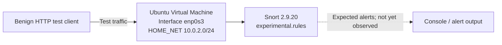

# Snort Intrusion Detection: Rule Setup and Validation

**Focus:** IDS · Linux · Snort 2.9 · signature rules · troubleshooting  
**Course context:** CSCI 412 (Information Security), John Jay College of Criminal Justice  
**Status:** **Rule syntax/configuration validation succeeded; alert generation was *not* confirmed.**

## Goal
Install and configure a network intrusion detection system (Snort), load a simple custom content-matching signature, verify that Snort accepts the rule, and investigate why a live alert may not appear.

## Lab setup



This is a **logical demonstration**, not a claim that an alert was produced or that the shown topology was all separately verified.

## Tools and files
- Ubuntu/Linux, terminal, Snort **2.9.20**
- Snort configuration and custom rule file `/etc/snort/rules/experimental.rules`
- Network interface `enp0s3`
- `curl` for a benign HTTP test attempt
- [`rules/experimental.rules`](rules/experimental.rules): custom rule text restored from coursework notes
- [`scripts/validate-lab.sh`](scripts/validate-lab.sh): optional *new* validation helper

## Work performed
1. Set `HOME_NET` to `10.0.2.0/24` in the lab configuration.
2. Added a custom Snort content-matching TCP rule to `experimental.rules`.
3. Invoked Snort's validation mode using `snort -T`.
4. Observed successful initialization and **one loaded detection rule**.
5. Attempted a benign HTTP request to trigger the content match.
6. Checked the output: the `alert` file was absent and `snort.log` was zero bytes in the observed run.

## The original rule

```snort
alert tcp any any -> any any (content:"the"; msg:"The found ...."; sid:1000001; rev:1;)
```

This is the rule content transcribed from the notes. It is broad and suitable only for a simple course exercise, **not a production-quality signature**.

## Verified results vs. unresolved work

| Step | Observed status |
| --- | --- |
| Snort version identified | 2.9.20 |
| Rule file present | Yes, `/etc/snort/rules/experimental.rules` |
| Validation test `snort -T` | Successful — initialization complete, 1 rule loaded |
| HTTP test with `curl` | Command attempted |
| Intrusion alert screenshot / alert log | **Not captured / not observed** |
| Working end-to-end detection | **Not yet demonstrated** |

### Actual commands documented in the coursework

```bash
sudo snort -T -i enp0s3 -c /etc/snort/rules/experimental.rules
sudo snort -v -i enp0s3 -c /etc/snort/rules/experimental.rules -l /var/log/snort/
curl --max-time 15 http://example.com/the
```

The `-v` flag invokes verbose packet display and **is not the same as proof that alert output was configured**. The validation success alone does not establish that the live rule matched traffic.

## Evidence status
The original Snort terminal screenshots from the pinned chat were not available as exportable source files when this repository was prepared. No fabricated alert output is included. See [`evidence/README.md`](evidence/README.md) for exactly what should be captured in a repeat of the lab.

## Next verification steps (not represented as completed)
1. Confirm the custom rule is loaded through the actual Snort configuration being used for detection.
2. Start Snort in IDS alert mode, e.g. with `-A console`, on the correct interface in the isolated lab.
3. Send predictable benign payload containing `the` across the monitored interface; **localhost-to-localhost traffic may not traverse `enp0s3`**.
4. Record the console alert, logged rule SID, matching packet fields and time, and save an authentic screenshot.
5. Narrow the signature to a particular service/direction and evaluate false positives.

## What I'd improve
- Complete an end-to-end alert proof and include screenshots of a matched SID.
- Reduce noise by specifying the trusted subnet, destination port, and content inspection context.
- Explain the Snort 2.9 rule-loading path and test `-c` vs. rule include configuration.
- Document test packets and network-interface selection reproducibly.

## Provenance
The original Snort rule, configuration details, successful validation, and lack of observed alerts are from completed coursework steps. Scripts supplied here are **new portfolio helpers** and must not be described as work performed in the original lab. This is an introductory lab, not a deployed production IDS.
