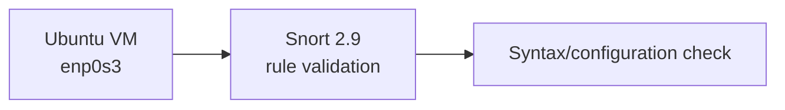

# Snort: Configuration and Rule Validation Exercise

An introductory Snort configuration exercise from **CSCI 412: Information Security**, John Jay College of Criminal Justice.

## Objective

Install Snort in a Linux virtual machine, configure its rule-loading environment, and check whether Snort accepts a basic test rule.

## Setup

## What I tested

- Worked with Snort 2.9 and a custom rule file in the lab environment.
- Adjusted the configured `HOME_NET` value for the virtual network.
- Ran a Snort validation check; the recorded terminal output indicated successful initialization and one rule loaded.
- Attempted HTTP test traffic and checked for resulting alerts.

**Outcome:** I verified rule loading, but I did **not** observe a matching intrusion alert. This repository therefore demonstrates configuration work and troubleshooting—not working end-to-end intrusion detection.

## About the test rule

The classroom exercise used a broad TCP content match on the word `the`. Such a match is **not a meaningful attack signature**: it can match ordinary benign traffic and has no useful specificity. I would not use it to identify malicious activity.

The exact lab rule and test commands should be revisited in a controlled environment before publishing a working signature or making detection claims.

## Next steps

1. Inspect the complete `snort.conf` and verify that the rules file is included.
2. Confirm the capture interface sees the test traffic.
3. Run Snort in an appropriate IDS alert mode and generate predictable test traffic on the monitored network.
4. Save genuine validation and alert output, then replace the trivial content match with a narrowly scoped, documented rule.
5. Explain expected false positives and validate the result across multiple test cases.

## Current evidence

Only the classroom troubleshooting and rule-validation notes are available here. No alert screenshot, alert log, or packet capture is published. This repo is a record of an early configuration exercise, **not a completed IDS deployment**.
